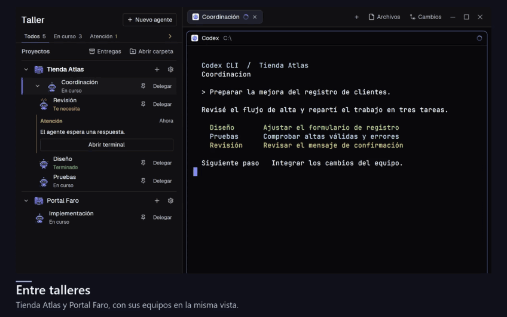

#  Rekindle

**Layout de código abierto para Codex CLI en Herdr Desktop para Windows.**

[Read in English](README.md)

Rekindle reúne los proyectos, agentes y subagentes en un mismo espacio. Los sprites animados muestran quién está trabajando, quién necesita atención y quién ha terminado. Cada agente arranca con las skills de su tipo y las que elijas para el proyecto. Puedes delegarle tareas a un subagente y seguir su progreso desde el equipo.

[Descargar la última versión](https://github.com/Alexrb11/rekindle/releases/latest)

## Vista previa



Grabada en Herdr con proyectos y un motor de ejemplo.

[Vídeo en inglés (MP4)](media/demo.mp4?raw=true) · [Captura del layout](layout/preview.png)

## Instalación

Necesitas Herdr de escritorio con herdr-core, Codex CLI y una terminal de Herdr que cargue un perfil de PowerShell. [Herdr para Windows](https://herdr.dev/download/), [Codex CLI](https://developers.openai.com/codex/cli/)

1. Descarga y extrae el ZIP, o clona el código. Abre PowerShell en la carpeta del proyecto.
2. Instala el layout y la recuperación de chats.

   ```powershell
   .\Install.ps1 -Component All
   ```

3. Abre Herdr y selecciona Rekindle.

   ```powershell
   herdr-app do layout.switch --name rekindle
   ```

Usa `-Component Layout` para instalar el layout, la paleta, los sprites y los paneles. Usa `-Component Chats` para instalar la recuperación y su panel independiente. Añade `-WhatIf` para revisar los cambios. Si Windows bloquea el instalador descargado, revisa el archivo y ejecuta `Unblock-File -LiteralPath .\Install.ps1`.

## Usar Rekindle

- Pulsa **Abrir carpeta** para añadir un proyecto. Pulsa su icono para elegir un color de sprite o un logo propio. Arrastra el tirador junto al proyecto para reordenarlo.
- Tras una instalación nueva, abre **Nuevo agente** y pulsa **Nuevo tipo** para crear el primero. Elige su color de sprite y las skills de inicio que quieras. Pulsa el botón de edición junto a un tipo guardado para cambiarlo o eliminarlo. También puedes elegir skills del proyecto en `.agents/skills/<nombre>/SKILL.md`.
- Cada agente muestra el título de su conversación. Pasa el cursor sobre el sprite para ver el tipo. En **⋯** puedes delegar, cambiar el nombre, detener la tarea actual o eliminar al agente. Al detener la tarea, la conversación sigue abierta. Si borras el nombre personalizado, vuelve a aparecer el título de la conversación. Al eliminar un agente, Herdr pide confirmación y cierra también sus subagentes.
- Pulsa la lupa para encontrar conversaciones por título o nombre personalizado y abrir proyectos por nombre o carpeta. La búsqueda incluye los equipos plegados.
- Los agentes fijados quedan arriba en cada proyecto. Los demás se ordenan por uso reciente. Al principio se muestran cuatro y **Ver más** añade los siguientes cuatro.
- Abre **Entregas** para revisar resultados de Codex, archivos modificados y pruebas. La barra de estado muestra el uso de Codex y permite configurar un aviso de cuota baja.
- Pulsa **EN** o **ES** en la barra lateral para cambiar el idioma. Herdr recuerda el ajuste y lo aplica al panel de recuperación.

El layout usa la terminal y los paneles de archivos y cambios de Herdr. En Windows lee los registros locales de Codex, ejecuta Git para los diffs y consulta la cuota mediante el servidor de Codex instalado. [Receta del layout](layout/RECIPE.md)

## Recuperar chats

Con `-Component All` o `-Component Chats`, abre un panel nuevo de Codex. Escribe `/hooks` y marca como confiable el hook `SessionStart` que ejecuta `herdr-codex-session.ps1`. Envía un mensaje y deja el panel abierto para el próximo inicio. [Revisión de hooks de Codex](https://learn.chatgpt.com/docs/hooks#review-and-trust-hooks)

Abre el contador de chats guardados con `herdr-app do mod.open --name rekindle`. Los chats de paneles que hayas cerrado siguen disponibles con `codex resume --all`.

## Desinstalación

```powershell
.\Install.ps1 -Component All -Uninstall
```

Cambia de layout antes de desinstalar y usa las mismas opciones de componente y rutas que en la instalación. El desinstalador conserva los archivos del layout que hayas editado, los tipos de agente, tus otros hooks y las conversaciones.

## Créditos

Creado por **Alex Rubio**. [alexrubio.dev](https://alexrubio.dev/)
