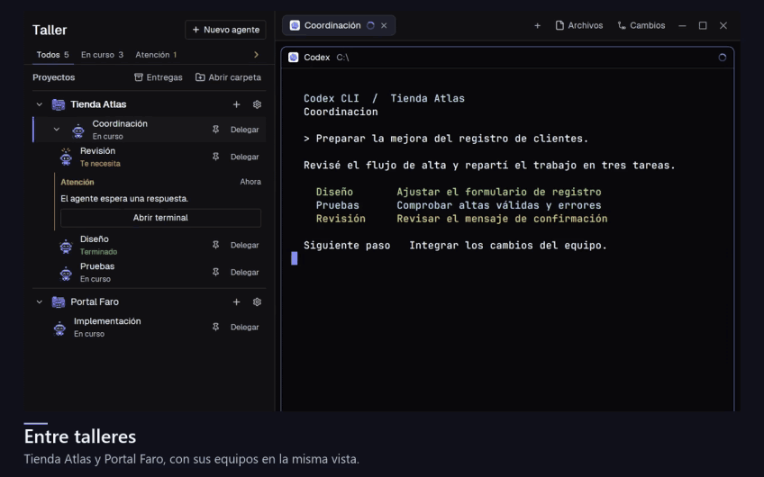

#  Rekindle

**An open-source Herdr Desktop layout for Codex CLI on Windows.**

[Leer en español](README.es.md)

Rekindle groups projects, agents, and subagents in one workspace. Animated sprites show who's working, who needs attention, and who has finished. Launch an agent with the skills for its type and project, then delegate tasks from that agent and follow its subagents in the same team.

[Download the latest release](https://github.com/Alexrb11/rekindle/releases/latest)

## Preview



Recorded in Herdr with sample projects and a demo engine.

[MP4 video](media/demo.mp4?raw=true) · [Layout screenshot](layout/preview.png)

## Requirements

- Windows with Herdr Desktop, its local herdr-core, and Codex CLI.
- A Herdr shell running Windows PowerShell 5.1 or PowerShell 7. The Codex hook uses the Windows PowerShell executable.

The full layout was verified on Windows 11 with Herdr Desktop 0.1.17 and herdr-core 0.1.22. Its installer was tested with Windows PowerShell 5.1 and PowerShell 7. [Herdr Desktop](https://herdr.dev/download/) · [Codex CLI](https://developers.openai.com/codex/cli/)

## Install

1. Download and extract the release ZIP, or clone the source. Open PowerShell in the project folder.
2. Install the layout and chat recovery.

   ```powershell
   .\Install.ps1 -Component All
   ```

3. Open Herdr and switch to Rekindle.

   ```powershell
   herdr-app do layout.switch --name rekindle
   ```

Use `-Component Layout` to install the layout, palette, sprites, and workspace panels. Use `-Component Chats` to install chat recovery and its standalone panel. Add `-WhatIf` to preview file changes. If Windows blocks the downloaded installer, review it and run `Unblock-File -LiteralPath .\Install.ps1`.

## Use Rekindle

- Choose **Open folder** to add a project. Click its icon to change its sprite color or set a custom logo. Drag the handle next to a project to reorder it.
- On a fresh install, open **New agent** and choose **New type** to create your first agent type. Pick its sprite color and optional startup skills. Use the edit button next to a saved type to change it or remove it. Choose additional project skills from `.agents/skills/<name>/SKILL.md`.
  Codex opens an empty conversation with the selected skill references in its session instructions.
- Select **Done** next to **Attention** to revisit agents and subagents that have finished a task.
- Each agent row shows its conversation title. Hover over the sprite to see the agent type. Open **⋯** to delegate, rename, stop the current task, or delete the agent. Stopping a task keeps the conversation open. Clearing a custom name restores the conversation title. Deleting an agent asks for confirmation and closes its subagents too.
- Use the search icon to find conversations by title or custom name and open projects by name or folder. Search includes folded project teams.
- Pinned agents stay at the top of each project. By default, the other agents appear in order of most recent use, four at a time. **Rekindle settings** lets you change the order and the size of each group.
- Open **Deliveries** to review Codex results, changed files, and checks. The status bar shows Codex usage and can alert when a quota drops below your chosen threshold.
- Select **EN** or **ES** in the sidebar to change language. Herdr remembers the choice and shares it with the chat recovery panel.
- Open **Rekindle settings** at the bottom of the sidebar to choose its density, visible elements, launch warning, and Codex quota refresh frequency. Preferences apply immediately and can be reset to their defaults.
- In **Preferences → Projects and agents**, choose **Codex launch permissions** for new agents and subagents. Pick **Codex settings**, **Read only**, **Workspace**, or **Full access**. Full access runs commands without approval prompts.
- The **Backups** tab exports and imports a ZIP with your preferences, agent types, sprite colors, and project logos. Import combines agent types by name. Project artwork is restored as you open matching projects.

The layout uses Herdr's native terminal, Files, and Changes panels. Its Windows status and delivery panels read local Codex session records, run Git for diffs, and ask the installed Codex app server for quota. [Layout recipe](layout/RECIPE.md)

## Chat recovery

With `-Component All` or `-Component Chats`, open a new Codex pane. Use `/hooks` to trust the `SessionStart` hook that runs `herdr-codex-session.ps1`. Send a message and keep the pane open for the next startup. [Codex hook review](https://learn.chatgpt.com/docs/hooks#review-and-trust-hooks)

Open the saved-chat count and language controls with `herdr-app do mod.open --name rekindle`.

The chat installer uses `CODEX_HOME` when set, or `%USERPROFILE%\.codex`, and finds profiles for the installed PowerShell editions. For a custom setup, use `-CodexDirectory`, `-ProfilePaths`, or `-HerdrAppDirectory`. For a symlinked profile, pass its target path.

The first message makes a new Codex chat available to resume. Herdr's Codex menu gives each pane an independent Codex process. The installer also gives plain `codex` the same behavior inside new Herdr PowerShell panes, where you have no existing alias or function for it. With a custom launcher, start Codex with `--no-daemon`. [Herdr program launch documentation](https://github.com/herdrdev/herdr-app/blob/master/defaults/AGENTS.md#programs-programsjson)

When herdr-core recreates a kept pane, the PowerShell profile runs `codex --no-daemon resume <id>`. It opens the chat and waits for your input. Closing the Herdr window leaves existing processes running. Closing a pane removes it from automatic recovery. If you exit Codex and leave its shell open, the pane still remembers its last chat. [Herdr terminal lifecycle](https://github.com/herdrdev/herdr-app/blob/v0.1.16/README.md)

For a conversation in a pane you already closed, use `codex resume --all` to choose it manually. For automatic recovery, use Herdr's local Windows panes and a PowerShell profile that loads at startup.

The integration stores the chat ID and the terminal process start time in the `codex.resume` label in herdr-core's local state. Codex keeps the conversation history in its own storage.

## Uninstall

```powershell
.\Install.ps1 -Component All -Uninstall
```

Switch to another layout first. Use the same component and path options as at install time. The installer preserves edited layout files, agent type settings, other hooks, and conversations.

## Verify changes

```powershell
.\tests\Install.Tests.ps1
.\tests\Layout.Tests.ps1
powershell.exe -NoProfile -File .\tests\Resume.Tests.ps1
```

The installer test uses temporary profiles and hook configurations. The restore test uses the installed [herdr-core CLI](https://herdr.dev/core/) with a separate state directory and a simulated Codex executable. It stops and starts that instance and checks that two panes each resume their exact ID. It can run without a Codex login.

## Credits

Created by **Alex Rubio**. [alexrubio.dev](https://alexrubio.dev/)

Licensed under [MIT](LICENSE).
