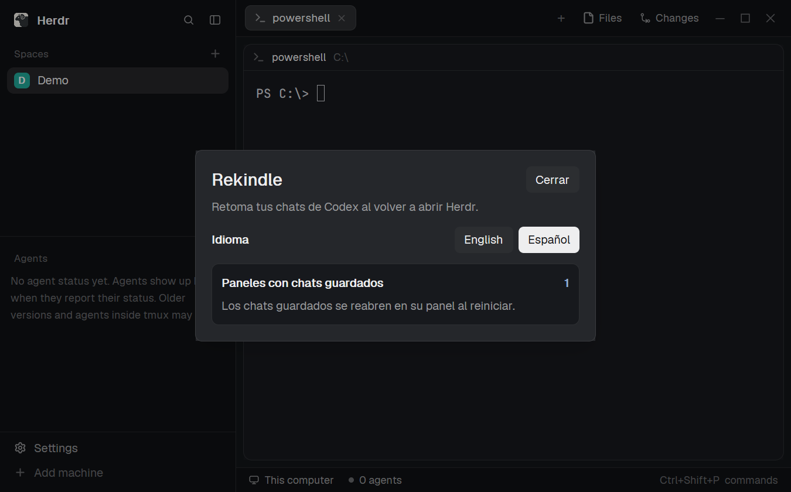

# Rekindle

Rekindle shows how many local Herdr panes have a saved Codex chat. It runs alongside the Rekindle PowerShell integration for Codex CLI on Windows. Created by Alex Rubio. [alexrubio.dev](https://alexrubio.dev/)

## What you see

A 456 × 218 point dialog follows the current Herdr theme. An 18-point inset holds the title and close button, a short description, and a row with the language label and the **English** and **Español** controls. A bordered card at the bottom gives the saved-pane count and a short description of what to do next or what will happen on restart.

## How it behaves

Open it with `herdr-app do mod.open --name rekindle`. The selected language has the solid button style. Clicking the other language translates the labels and description immediately. In the focused dialog, the left and right arrow keys select English and Spanish. The close button dismisses the dialog.

English is the initial choice. Herdr keeps the most recent selection for the next panel or app launch. The count updates with the terminal list. At zero, the card explains how to save a chat. With saved panes, it explains that their chats will reopen in place.

## Built from

- `mods/rekindle/mod.json` declares a dialog with `place: "none"` and its dimensions.
- `mods/rekindle/main.js` renders the dialog with `gpui-kit` and `gpui-base`. It reads Herdr's `theme()` and `terminals()`, uses `shared()` and `setShared()` with the key `rekindle.language`, and dismisses itself with `closeOverlay()`.
- The count uses the `codex.resume` label written by the existing PowerShell integration. It includes live local terminals whose label contains a session UUID and a process start timestamp.

## Watch out

The panel is the Herdr companion to the PowerShell installer. Set up the recovery hook to start recording chat IDs after the first message. The full Rekindle workspace, including its animated sprites, has a separate recipe. [Chat recovery](README.md#chat-recovery) · [Rekindle layout](layout/RECIPE.md)

## Done when

- `herdr-app check mods/rekindle` passes.
- The dialog opens in Herdr, and both language controls update the labels and selected style.
- Closing and reopening Herdr preserves the chosen language.
- With a saved local Codex pane, the count shows one. Finished and remote terminals stay outside the count.
