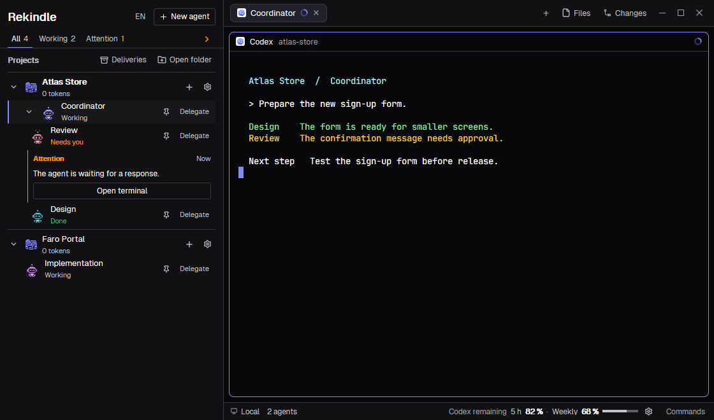

# Rekindle

Rekindle is a dark Herdr Desktop workspace for Codex CLI projects on Windows. The sidebar groups projects and their agent teams, with animated pixel sprites for each agent's status. The workspace combines terminals, project files, changes, a skill-aware agent picker, task delegation, and a Codex status bar. Created by Alex Rubio. [alexrubio.dev](https://alexrubio.dev/)

## What you see

The layout starts with a 350-point sidebar with a 300-point minimum. The header has the Rekindle name, an English or Spanish control, and a button for a new agent. Filters show all agents, working agents, or agents that need attention. Each project has a logo, a fold control, an agent launcher, and project settings. Its team is a nested tree of parent agents and subagents.

On the right, a 42-point tab bar sits above the active terminal. The optional Files and Changes panels open to the right of the terminal. A 28-point footer shows the machine, branch, active agent counts, Codex quota, and command palette. The theme uses a near-black canvas, dark gray panels, and indigo accents. The bundled sprite sheets include indigo, mint, sky, coral, gold, and violet variants for agents and projects.

## How it behaves

- A project opens from a folder. Click its icon to recolor the project sprite or apply a PNG, JPG, WebP, or SVG logo. Expand a project's team or a parent row to see the tree.
- Working sprites move through their work frames. Blocked sprites show an attention marker and the current request. Finished sprites show completion and idle sprites blink. A single sidebar timer redraws only when the frame changes.
- The agent picker starts with General, Design, Review, and Testing. Add or edit a type to specify startup skills in order. The picker scans the project for `.agents/skills/<name>/SKILL.md` and merges selected project skills with the type's skills at launch. Each skill can have its own sprite color.
- **Delegate** opens the picker for a living parent terminal. Choose the type and enter a task. The picker starts a child terminal via `hc` with the parent address and the type label. The child appears beneath its parent. Focus or peek into its terminal from the team.
- **Deliveries** displays local Codex results, changed files, and checks. Open the diff or mark a delivery reviewed. The footer can refresh quota and configure a low-quota notification.
- The language control writes `rekindle.language` to shared state. It also selects the language of the optional chat recovery panel. The optional keyboard binding in `keys.json` moves to the next agent that needs attention.

## Built from

- `layouts/rekindle.json` defines the sidebar and work column. The work column holds the tabs, an active terminal with Herdr's built-in `pane` header, a stack of Herdr's `files` and `changes` mods, and the status footer.
- `themes/rekindle.json` supplies the terminal palette and UI colors. `mods/rekindle-sidebar/art` holds the original project art and agent sprite frames.
- `rekindle-sidebar` renders projects, agent state, requests, and team relationships. It also opens the project settings and logo dialogs. `rekindle-agents` renders the picker, type editor, project skill chooser, and delegation form. `rekindle-tabs` provides navigation and toggles for the right-hand panels.
- `rekindle-status` and `rekindle-deliveries` share status and review records. On Windows, their PowerShell helpers read Codex session logs and the local session index, launch Codex's app server to get quota, and run Git to render changed files. Authoring actions use Herdr's `exec`, `hc`, and file APIs. Project skill discovery reads files beneath the project.
- Herdr keeps user settings, logos, review state, and agent types in its application home. The type editor saves to `data/rekindle-agent-types.json`. The built-in types are available on the first launch.

## Watch out

Install the layout, theme, and all five module folders together. The Windows installer in the repository root copies them with `-Component Layout`, including the preview as `layouts/rekindle.png`. Copy the optional binding in `keys.json` into the layout-specific section of your Herdr bindings if you want the shortcut.

Agent launch requires a locally or remotely installed engine. The Codex usage and delivery features use Windows PowerShell and the installed Windows Codex CLI. Git is needed for diffs. Status and review data are local to the installed app and projects. The repository's separate chat recovery component is available with `-Component All`. [Installation guide](../README.md#install)

## Done when

- `herdr-app check` passes for each installed module, and `herdr-app do layout.switch --name rekindle` opens the workspace.
- Two projects render distinct teams. A parent with children expands and collapses. Each agent's activity is visible in its sprite.
- The project picker finds a sample skill. Delegating a task starts a child terminal with the chosen type and skill and shows it in the team.
- The English and Spanish controls update the sidebar, picker, tab bar, deliveries, and status without restarting.
